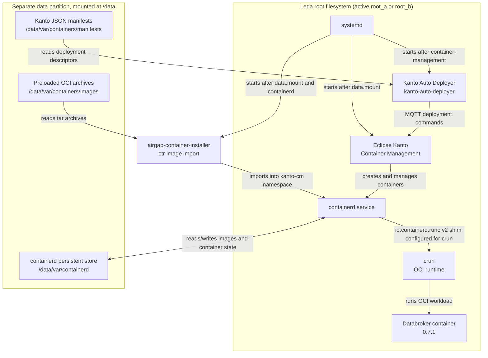

# Container build workflows

Leda has separate mechanisms for running, deploying, and building containers.
They serve different purposes and are not all enabled by the default image.

## Overview

- Eclipse Kanto: supports OCI-compliant container images (e.g. Docker, Podman), container management for resource-constrained devices, optimized for standardized OTA and Digital Twin use cases of edge devices
- Northstar: proprietary format for even more resource-constrained devices where the container images are pre-baked for specific device configurations

## Runtime and deployment

- `containerd` stores and runs OCI images. Kanto manifests name the
  `io.containerd.runc.v2` shim; Leda configures that shim to execute `/usr/bin/crun`.
  `crun` is the OCI runtime, not a second container manager.
- Eclipse Kanto Container Management (`container-management`) manages containers
  through containerd.
- Kanto Auto Deployer (`kanto-auto-deployer`) reads the JSON manifests installed
  under `/data/var/containers/manifests` and deploys them at startup. The systemd
  service is enabled in the standard images.
- `sdv-core-containers` and `sdv-example-containers` install deployment manifests;
  they do not contain the referenced image layers.

### Runtime data and command flow

The following shows the default airgap-enabled image at runtime. The `data`
partition is mounted at `/data`; it contains the Kanto manifests, preloaded OCI
archives, and containerd's persistent store.



The installer is ordered after both `containerd.service` and `data.mount`, and
before `container-management.service`. Container Management also waits for the
data mount. Auto Deployer starts after Container Management and reads manifests
from the mounted data partition, then submits deployment commands over Kanto's
MQTT interface. Imported images and deployed-container state are kept by
containerd under `/data/var/containerd`.

The default distro enables `airgap-containers`. Its image archives are installed
into `sdv-image-data` under `/var/containers/images`, which is mounted at
`/data/var/containers/images` on the running system. The
`airgap-container-installer` service imports those archives into containerd's
`kanto-cm` namespace before `container-management` starts. The core Databroker
manifest and its cached image both use `ghcr.io/eclipse-kuksa/kuksa-databroker:0.7.1`.
The `databroker-cli` is a native Leda package, not a container; the distro pins
both native recipes to 0.7.1.

In airgap mode, the example `feedergps` and `node-red` manifests are not installed
because their images are not in the default airgap package group. With the
`airgap-containers` distro feature removed, these examples are deployed normally
and may require registry access.

## Build an application package with BitBake

This is the normal Yocto source-to-package flow. It builds the target binary and
package; it does not create or deploy a container image.

```mermaid
flowchart TD
    MAINTAINER@{ shape: "person", label: "Leda Maintainer" }
    UPSTREAM["Upstream source<br/>Git or release archive"]
    RECIPE["Application BitBake recipe<br/>SRC_URI + pinned SRCREV"]
    FETCH["do_fetch / do_unpack"]
    BUILD["do_configure / do_compile"]
    INSTALL["do_install"]
    PACKAGE["Target package<br/>binary + runtime files"]
    FEED["BitBake package feed / sysroot"]

    MAINTAINER -->|"selects source, reviews and pins revision"| RECIPE
    UPSTREAM --> FETCH
    RECIPE --> FETCH
    FETCH --> BUILD
    BUILD --> INSTALL
    INSTALL --> PACKAGE
    PACKAGE --> FEED
```

Add or update the application recipe in
`meta-leda-components/recipes-sdv/<component>/`. Pin `SRC_URI` and `SRCREV` (or
use a versioned release archive), declare dependencies and license information,
and install the target executable through `do_install`. Review and test the
source/package change before using that package in an OCI image.

```sh
kas shell kas/leda-qemux86-64.yaml -c 'bitbake <application-recipe>'
```

For example, the Databroker application package target is `databroker` (the
native CLI is a separate target, `databroker-cli`):

```sh
kas shell kas/leda-qemux86-64.yaml -c 'bitbake databroker'
```

## Create an OCI image from a BitBake package

This flow starts with a target package built by BitBake above. The container
recipe assembles that package into an OCI image; it is separate from the recipe
that originally built the application package.

```mermaid
flowchart TD
    MAINTAINER@{ shape: "person", label: "Leda Maintainer" }
    PACKAGE["Previously built target package"]
    RECIPE["OCI image recipe<br/>meta-leda-distro-container"]
    ROOTFS["Container root filesystem<br/>IMAGE_INSTALL"]
    OCI["image-oci task"]
    TAR["Machine-specific OCI archive<br/>DEPLOY_DIR_IMAGE"]
    BUNDLE["Optional sdv-container-images bundle"]
    MANIFEST["Maintainer-authored Kanto JSON<br/>image reference/tag + runtime config"]
    MANIFEST_RECIPE["sdv-core-containers or<br/>sdv-example-containers"]
    DATA["sdv-image-data<br/>separate /data partition"]
    FINAL["sdv-image-all<br/>bootable disk image"]

    MAINTAINER -->|"maintains recipe, entrypoint and OCI_IMAGE_*"| RECIPE
    PACKAGE -->|"IMAGE_INSTALL resolves package"| ROOTFS
    RECIPE --> ROOTFS
    ROOTFS --> OCI
    OCI --> TAR
    MAINTAINER -->|"adds target to CONTAINER_IMAGES if bundling"| BUNDLE
    TAR -.-> BUNDLE
    MAINTAINER -->|"authors manifest; validates ref/tag"| MANIFEST
    MANIFEST -->|"SRC_URI + do_install"| MANIFEST_RECIPE
    MANIFEST_RECIPE --> DATA
    BUNDLE -.->|"requires explicit integration;<br/>not in default image"| DATA
    DATA --> FINAL
    MAINTAINER -->|"reviews package/image/manifest and runs build"| FINAL
```

Create the OCI recipe under
`meta-leda-distro-container/recipes-sdv/sdv-containers/`. Inherit
`../images/sdv-image-container.bb`, add the application package to
`IMAGE_INSTALL`, and set `OCI_IMAGE_TAG`, entrypoint, ports and environment as
needed. Build one image or the existing bundle with:

```sh
kas shell kas/leda-qemux86-64.yaml -c 'bitbake <container-image-recipe>'
kas shell kas/leda-qemux86-64.yaml -c 'bitbake sdv-container-images'
```

The Databroker OCI recipe target is `databroker-container` (not
`sdv-kuksa-databroker-container`). Build it with:

```sh
kas shell kas/leda-qemux86-64.yaml -c 'bitbake databroker-container'
```

This builds a local Databroker OCI image. The machine-specific OCI tar is emitted
under `build/tmp/deploy/images/<machine>/`.
`sdv-container-images` bundles the image targets named in `CONTAINER_IMAGES`,
but that bundle is not included in default `sdv-image-all`. To deploy a
locally-built OCI image from the standard disk image, maintainers must integrate
its archive into `sdv-image-data`.

The Kanto JSON is a separate deployment descriptor, not generated from the OCI
recipe. Add or update it under
`meta-leda-components/recipes-sdv/eclipse-leda/kanto-containers/`, then update
the appropriate `sdv-core-containers.bb` or `sdv-example-containers.bb`
`SRC_URI`, `do_install`, and `FILES` entries. For an airgap image, include the
matching archive and ensure the manifest uses the exact image reference/tag.

## Maintain a service with native and container deployment modes

Kura is the first example of a build-time choice between an enabled native
systemd service and a Kanto-managed container built from the same application
recipe. This is currently a **Kura-specific implementation**, not a generic
deployment class or a runtime switch. Use it as a reference when integrating
another service; the variable names below are the implemented interface.

### Select the deployment

The distro configuration defines:

```bitbake
LEDA_YORIITO_DEPLOYMENT ?= "native"
LEDA_YORIITO_CONTAINER_REF = "localhost/leda/kura:integration"
```

`LEDA_YORIITO_DEPLOYMENT` accepts `native` or `container`. The data image rejects
other values during parsing. The image reference is shared by the archive
recipe and deployment descriptor, so they name exactly the same imported image.
The `integration` tag is a local development tag, not an upstream release or
an immutable digest; source reproducibility still depends on the application
and layer revisions selected by the build.

Users select container mode through a KAS overlay,
[kas/yoriito-container.yaml](../kas/yoriito-container.yaml):

```yaml
header:
  version: 12

local_conf_header:
  yoriito-container: |
    LEDA_YORIITO_DEPLOYMENT = "container"
```

Build and launch with the same configuration:

```sh
kas build kas/leda-qemux86-64.yaml:kas/yoriito-container.yaml
kas shell kas/leda-qemux86-64.yaml:kas/yoriito-container.yaml \
  -c 'runqemu slirp ovmf kvm nographic sdv-image-all'
```

Omit the overlay for native mode. `scripts/leda` uses the native configuration,
so use the explicit launch command above for container mode.

### Recipes and configuration a maintainer must wire together

Paths in this table are relative to the `meta-leda` layer repository:

| Surface | Kura reference | Responsibility |
| --- | --- | --- |
| Application recipe or append | [kura_git.bbappend](../meta-leda/meta-leda-components/recipes-sdv/yoriito/kura_git.bbappend) | Reuse the upstream application build; control native service enablement. |
| OCI image recipe | [sdv-image-kura.bb](../meta-leda/meta-leda-distro-container/recipes-sdv/images/sdv-image-kura.bb) | Assemble target packages and define the container entrypoint. |
| Offline archive package | [sdv-container-kura.bb](../meta-leda/meta-leda-components/recipes-sdv/yoriito/sdv-container-kura.bb) | Convert the local OCI image into an importable, machine-specific archive. |
| Deployment package and JSON | [sdv-kura-deployment.bb](../meta-leda/meta-leda-components/recipes-sdv/yoriito/sdv-kura-deployment.bb), [kura.json](../meta-leda/meta-leda-components/recipes-sdv/yoriito/files/kura.json) | Install an active Kanto descriptor using the same image reference. |
| Host package group | [packagegroup-sdv-yoriito.bb](../meta-leda/meta-leda-components/recipes-sdv/yoriito/packagegroup-sdv-yoriito.bb) | Retain native client tools and include the archive installer in container mode. |
| Data image selection | [sdv-image-data.bb](../meta-leda/meta-leda-distro/recipes-sdv-distro/images/sdv-image-data.bb) | Include archive and descriptor together, only in container mode; validate the selection. |
| Distro defaults | [leda.conf](../meta-leda/meta-leda-distro/conf/distro/leda.conf) | Define deployment default and the shared image reference. |

The application recipe can remain in its upstream layer. A `.bbappend` matches
the recipe filename/version and must be covered by the layer's `BBFILES`;
its directory need not match the upstream recipe directory.

#### 1. Keep application packaging separate from host activation

Do not add a second build of the application just for its container. Keep the
binary, runtime dependencies, configuration, and systemd unit in the existing
packages. Kura's append selects service enablement with:

```bitbake
SYSTEMD_AUTO_ENABLE:${PN} = "${@'disable' if d.getVar('LEDA_YORIITO_DEPLOYMENT') == 'container' else 'enable'}"
```

Use the package that actually owns the unit if it differs from `${PN}`.
Disabling auto-enable is not masking the service or removing its executable:
Kura's host binary remains installed, but must not run alongside its container.
Clients such as `vshot` remain native in both modes.

#### 2. Build a minimal OCI runtime from the application packages

Kura's image recipe inherits `image image-oci` directly:

```bitbake
inherit image image-oci

IMAGE_FSTYPES = "container oci"
IMAGE_FEATURES = ""
IMAGE_LINGUAS = ""
IMAGE_INSTALL = "base-files base-passwd busybox kura yoriito-vss"
NO_RECOMMENDATIONS = "1"
IMAGE_CONTAINER_NO_DUMMY = "1"

OCI_IMAGE_TAG = "integration"
OCI_IMAGE_ENTRYPOINT = "/usr/bin/kura"
OCI_IMAGE_CMD = "--config-file-path /etc/yoriito/viss/config.yml"
OCI_IMAGE_WORKINGDIR = "/etc/yoriito/viss"
OCI_IMAGE_PORTS = "50052/tcp 50053/tcp"
OCI_IMAGE_APP_RECIPE = "kura"
```

Also provide the recipe's summary and license metadata. `IMAGE_INSTALL` names
target packages, not recipe dependencies or host-side deployment packages.
Include the configuration/data the application needs, and verify that the
entrypoint stays in the foreground. `OCI_IMAGE_PORTS` is metadata; it does not
publish ports or change the addresses on which the application listens.

#### 3. Package the local image for offline import

The archive recipe uses `DEPENDS = "skopeo-native"` and:

```bitbake
do_install[depends] += "sdv-image-kura:do_image_complete"
PACKAGE_ARCH = "${MACHINE_ARCH}"
```

The explicit task dependency ensures the machine's OCI output exists before
conversion. Kura converts the deployed layout with:

```sh
skopeo --insecure-policy copy \
    oci:${DEPLOY_DIR_IMAGE}/sdv-image-kura-integration-oci:integration \
    docker-archive:${B}/kura.tar:${LEDA_YORIITO_CONTAINER_REF}
```

These are BitBake task-body variables. `--insecure-policy` accepts the locally
built unsigned image; it does not disable registry TLS. Keep the layout path
and source tag in sync with the OCI recipe.

Install the result under `${D}/var/containers/images/kura-<sha256>.tar`,
where the hash is computed from the archive, and list it in `FILES:${PN}`.
Kura names the destination directory through `CONTAINERS_TARGET_PATH`.
The content-dependent filename matters: the current importer caches successful
imports by archive basename and would skip changed content under an old name.

At runtime this data-image path becomes
`/data/var/containers/images/kura-<sha256>.tar`.
`PREINSTALLED_CTR_IMAGES_DIR` configures the host installer to read that mounted
directory. Do not install the archive under an extra `/data` prefix inside the
data image.

#### 4. Install the matching Kanto descriptor

The deployment recipe inherits `kanto-auto-deployer`, fetches its JSON through
`SRC_URI`, and installs it into `${D}${KANTO_MANIFESTS_LOCAL_DIR}`.
The class defaults `KANTO_MANIFESTS_LOCAL_DIR` to `/var/containers/manifests`;
the guest sees it under `/data/var/containers/manifests`.
Declare the installed JSON in `FILES:${PN}`.

Kura replaces the JSON's `@KURA_IMAGE@` placeholder with
`${LEDA_YORIITO_CONTAINER_REF}` during `do_install`. A matching name/tag is
essential: an archive alone does not deploy a container, and a descriptor
without its local image may cause an unwanted registry pull.

Choose networking, mounts, privileges, and restart policy for the application,
not by copying another service blindly. Kura requires host networking because
its gRPC servers bind to loopback. It uses `io.containerd.runc.v2`, runs without
privileged mode, and bakes configuration/VSS into the image without host mounts.
The pinned Kanto version has no read-only bind-mount field; do not assume a
Docker option is supported by its descriptor schema.

#### 5. Select both data packages and the host importer

The data image appends `sdv-kura-deployment sdv-container-kura` to `IMAGE_INSTALL`
only when `LEDA_YORIITO_DEPLOYMENT` is `container`.
The host Yoriito package group similarly appends `airgap-container-installer`
to `RDEPENDS:${PN}` in that mode. This is deliberately independent of the
optional `airgap-containers` feature: a local-only image must be importable even
when unrelated cached examples are disabled.

Keep host clients in the full image, not the data partition or only inside the
container. Do not add the new service to minimal/rescue images unintentionally.
Kura does not modify the generic airgap package group or the existing
core/example manifests.

### Validation and mode-switching checklist

- Inspect effective `SYSTEMD_AUTO_ENABLE`, package-group `RDEPENDS`, and data
  `IMAGE_INSTALL` with `bitbake -e` for both modes. Reject invalid selections.
- Build the application, OCI image, archive, and deployment packages, then
  `sdv-image-all`. A successful OCI build alone does not update the boot disk.
- Test container mode with `airgap-containers` removed as well as enabled.
- Boot a fresh disk and verify native service disablement, successful archive
  import, the exact image reference, and a single running Kanto deployment.
- Exercise the actual client API, not just an open socket or container status.
  For Kura, write and read `Vehicle.Speed` with guest-side `vshot`.
- Check archive size, unpacked runtime storage, and free root/data space.
  Verify each supported architecture separately.
- Recheck native mode so the existing service and client workflow still work.

Deployment selection is a build-time policy, not a live migration mechanism.
Changing only a RAUC rootfs slot leaves persistent manifests, imported images,
and container state on the data partition. For the current integration, boot a
fresh disk/data partition when switching modes; disabling native auto-start
alone does not remove a previously deployed container.

See the [Kura runtime guide](jaspar-yoriito-runtime.md#container-deployment)
for the tested build, inspection, and client commands.

## Deploy a prebuilt OCI image

Use this path when the OCI image is built elsewhere and Leda only needs to
include and deploy it. The default airgap configuration uses a remote registry
at image-build time. A pre-existing local OCI archive can also be supplied to
the cache recipe instead. In either case the target device imports the cached
archive; it does not need to pull the image at startup.

```mermaid
flowchart TD
    MAINTAINER@{ shape: "person", label: "Leda Maintainer" }
    UPSTREAM["Upstream project publishes OCI image"]
    REGISTRY["Remote OCI registry"]
    LOCAL["Local prebuilt OCI archive<br/>with matching image tag"]
    RECIPE["sdv-container-cache recipe<br/>SDV_IMAGE_REF + SDV_IMAGE_TAG"]
    SKOPEO["Build-time skopeo fetch<br/>(remote source)"]
    ARCHIVE["Versioned OCI archive<br/>in image package"]
    MANIFEST["Maintainer-authored Kanto JSON"]
    MANIFEST_RECIPE["sdv-core-containers or<br/>sdv-example-containers"]
    DATA["sdv-image-data<br/>/data partition"]
    FINAL["sdv-image-all"]
    IMPORT["airgap-container-installer<br/>at boot"]
    CTRD["containerd<br/>namespace kanto-cm"]
    KAD["kanto-auto-deployer<br/>at boot"]
    CM["container-management"]
    RUNTIME["containerd OCI runtime<br/>crun"]
    APP["Running container"]

    MAINTAINER -->|"reviews upstream release and pins ref/tag"| RECIPE
    UPSTREAM --> REGISTRY
    REGISTRY --> SKOPEO
    RECIPE --> SKOPEO
    SKOPEO --> ARCHIVE
    LOCAL -->|"pre-staged archive as recipe download"| ARCHIVE
    MAINTAINER -->|"authors manifest with identical ref/tag"| MANIFEST
    MANIFEST -->|"SRC_URI + do_install"| MANIFEST_RECIPE
    MANIFEST_RECIPE --> DATA
    ARCHIVE -->|"packagegroup-sdv-airgap-containers"| DATA
    DATA --> FINAL
    MAINTAINER -->|"reviews pairing and builds image"| FINAL
    FINAL -->|"boot; data mounted at /data"| IMPORT
    FINAL -->|"services start in dependency order"| KAD
    DATA -->|"OCI archives"| IMPORT
    DATA -->|"JSON manifests"| KAD
    IMPORT -->|"ctr image import"| CTRD
    KAD -->|"MQTT deployment command"| CM
    CM -->|"create/start/stop"| CTRD
    CTRD --> RUNTIME
    RUNTIME --> APP
```

Add or update a cache recipe in
`meta-leda-components/recipes-sdv/sdv-containers/`, inheriting
`sdv-container-cache`. Pin `SDV_IMAGE_REF` and `SDV_IMAGE_TAG`; `skopeo` fetches
that image during a connected build. The standard package group,
`packagegroup-sdv-airgap-containers`, selects cached images for `sdv-image-data`.
For a pre-staged local archive, supply the archive at the recipe's expected
`SDV_DL_FILE` in `DL_DIR` and ensure its embedded image tag matches the recipe.

Example targeted build:

```sh
kas shell kas/leda-qemux86-64.yaml -c 'bitbake sdv-kuksa-val-databroker'
```

Update the matching Kanto manifest under
`meta-leda-components/recipes-sdv/eclipse-leda/kanto-containers/`; maintainers
must verify the image name and tag exactly match the cache recipe and only
activate manifests for images included in the airgap package group. Then build
and boot the final image:

```sh
kas build kas/leda-qemux86-64.yaml
scripts/leda
```

Verify that the data partition and deployment services started successfully,
and that the Databroker container was deployed only once. The commands below
are run in the booted Leda system. Commit the `meta-leda` changes and update the
pinned layer revision in `kas/common-wrynose.yaml` for a reproducible downstream
build.

`sdv-image-all` composes the full, minimal, rescue, and data images. The data
image is written to the separate partition used for manifests, blueprints, and
cached image archives. `scripts/leda` starts the resulting QEMU image; it does
not build or pull containers at startup when the airgap path is used.

### Verify deployment with KantUI

KantUI (`kantui`) is a terminal TUI for human users to inspect and manage
containers through Kanto Container Management. It is included in
`sdv-image-full` via `packagegroup-sdv-additions`. After booting the image with
`scripts/leda`, log in to the running Leda system and start it:

```sh
kantui
```

In KantUI, inspect the container list and select the Databroker container.
Confirm that its image is `ghcr.io/eclipse-kuksa/kuksa-databroker:0.7.1` and
that its state is running. This shows that Container Management has a deployed
container using the expected image and that it is currently started. In a
connected deployment, the image may have been pulled from the registry; in the
default airgap deployment, the startup installer imports the matching cached
image archive before Auto Deployer creates and starts the container.

Check mount and service status with `systemctl`:

```sh
systemctl status data.mount containerd.service airgap-container-installer.service \
    container-management.service kanto-auto-deployer.service
```

Use the Kanto and containerd command-line tools to check the deployed
container's state, its image, and whether it has a running task:

```sh
kanto-cm list
ctr --namespace kanto-cm images list
ctr --namespace kanto-cm containers list
ctr --namespace kanto-cm tasks list
```

In the `kanto-cm list` output, confirm there is a single Databroker deployment
and that it is running with the 0.7.1 image. In `ctr` output, verify that the
image is present in the `kanto-cm` namespace, the container has been created,
and its task is running. The airgap image is imported during startup; a
connected Kanto deployment may instead pull it from its configured registry.

Inspect this boot's service logs for importer messages and Auto Deployer
deployment results:

```sh
journalctl --boot -u airgap-container-installer.service \
    -u container-management.service -u kanto-auto-deployer.service \
    --no-pager
```

KantUI, `kanto-cm`, and `ctr` show current state rather than a history of
startup events; use `systemctl status` and `journalctl` to verify service
startup and diagnose failures.
